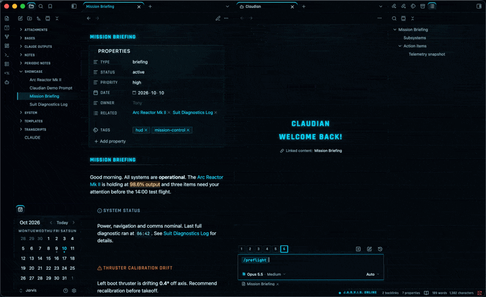

# Obsidian Jarvis HUD

A sci-fi HUD look for [Obsidian](https://obsidian.md), inspired by the holographic interfaces in the Iron Man and Avengers films. Cyan glow, a faint grid, angular headings and HUD-cornered callouts, built as CSS snippets on top of the [Minimal](https://github.com/kepano/obsidian-minimal) theme.

Want the same look in your terminal? Try [Terminal Jarvis HUD](https://github.com/andyjohansson/terminal-jarvis-hud), with a matching color profile, a HUD prompt and a J.A.R.V.I.S. greeting for macOS Terminal.



## What it does

- Near-black, blue-tinted background with arc-reactor cyan (`#00D8FF`) as accent and gold for highlights and warnings
- Faint HUD grid and a soft glow from the top of the editor
- Uppercase headings in Rajdhani, glowing H1 and inline title, cyan marker on H2
- Callouts with HUD corner brackets in each callout's own color
- Square, glowing checkboxes, outlined tags, HUD-style table headers and properties
- Cyan accents on the active tab, active file and command palette
- A pulsing `● J.A.R.V.I.S. ONLINE` indicator in the status bar
- HUD mouse cursors: a dark arrow with a cyan edge that lights up cyan with a HUD corner bracket on everything clickable, including Claudian, and a cyan I-beam over text. The typing caret is wider and glows
- Dark mode only, light mode is left untouched

## Requirements

- Obsidian with the **Minimal** theme enabled
- Optional: the **Style Settings** plugin, for toggles
- Internet on first load for the Google Fonts (Rajdhani, JetBrains Mono). Falls back to system fonts offline.

## Installation

1. Copy the files in `snippets/` into your vault's `.obsidian/snippets/` folder.
2. In Obsidian, go to **Settings → Appearance → CSS snippets**, refresh, and enable `jarvis-hud`. Add `jarvis-callouts` and `jarvis-claudian` if you want them.
3. Make sure you are in dark mode.

### Optional: Jarvis HUD FX plugin

A small companion plugin for Claudian. It does not modify Claudian.

- **Completion effect:** when a Claudian session completes, HUD corner brackets lock onto the session row and a glowing check mark appears where the arc reactor spinner was. CSS alone cannot tell a session that just finished from one that is re-rendered later, so this part needs a few lines of JavaScript.
- **Jarvis greetings:** the welcome screen says **J.A.R.V.I.S.** instead of Claudian, with one of 80+ dry Jarvis lines instead of "Hey there". Lines depend on the time of day, the day of the week and the calendar, from Halloween and Christmas to midsommar and kanelbullens dag. There is also a hidden way to ask Jarvis for another one.
- **Welcome reactor:** the arc reactor behind the welcome screen powers up and breathes while you type. When you send the first message it ignites: the inner arcs collapse into the core, the core flashes, a shockwave goes out, the ring blows outward and the text switches off like an old CRT screen. Visual only, no sound, and only transform and opacity are animated so it stays smooth. The reactor itself is in the snippet, the plugin adds the typing and send effects.
- **Archive effect:** when you archive a Claudian session, the same HUD corner brackets lock onto the row, squeeze into a glowing line and the row closes itself while the list closes up. If Claudian has not removed the session after 20 seconds, for example because the archive failed, the row comes back.
- **Greeting context (optional):** Claude knows which greeting you saw, so you can answer it. Reply "Yes, let's" to "Shall we get the hard thing done first?" and Claude gets the joke instead of asking what you mean. The greeting is not added to your message, it goes to Claude as hidden context with your first message only. Needs the hook below.

1. Copy the files in `plugin/` into `.obsidian/plugins/jarvis-hud-fx/` in your vault.
2. In Obsidian, go to **Settings → Community plugins**, refresh, and enable **Jarvis HUD FX**.
3. Keep `jarvis-claudian` enabled, since the effect itself lives in that snippet.

#### Optional: greeting context

When you send your first message from the welcome screen, the plugin saves the greeting to `greeting.txt` in its own folder. The Claude Code hook `greeting-hook.sh` passes it to Claude with that message and removes the file. A greeting older than a minute is dropped, so it never reaches an unrelated message.

Register the hook in your vault's `.claude/settings.local.json` (or `.claude/settings.json` if you share the vault setup), then start a new Claudian chat:

```json
{
  "hooks": {
    "UserPromptSubmit": [
      {
        "hooks": [
          {
            "type": "command",
            "command": "f=\"$CLAUDE_PROJECT_DIR/.obsidian/plugins/jarvis-hud-fx/greeting-hook.sh\"; [ -f \"$f\" ] && sh \"$f\"; exit 0"
          }
        ]
      }
    ]
  }
}
```

If the plugin is removed, the hook finds no script and does nothing.

## Files

| File | Purpose |
|---|---|
| `snippets/jarvis-hud.css` | The main HUD styling |
| `snippets/jarvis-callouts.css` | Custom callout types, e.g. `> [!calendar]` |
| `snippets/jarvis-claudian.css` | Styling for the [Claudian](https://github.com/YishenTu/claudian) plugin (Claude Code in Obsidian). Requires `jarvis-hud.css` |
| `plugin/` | Optional Jarvis HUD FX plugin, completion and archive effects, Jarvis greetings and welcome reactor effects for Claudian, plus `greeting-hook.sh` for the optional greeting context |

## Supported plugins

| Plugin | Support |
|---|---|
| [Style Settings](https://github.com/mgmeyers/obsidian-style-settings) | Adds a **Jarvis HUD** section with toggles, see below |
| [Calendar](https://github.com/liamcain/obsidian-calendar-plugin) | Works with the HUD styling |
| [Claudian](https://github.com/YishenTu/claudian) | Full HUD styling for the chat view via `jarvis-claudian.css` |
| [Iconic](https://github.com/gfxholo/iconic) | Note titles with an icon keep the readable line width |

Other plugins inherit the base colors and fonts from `jarvis-hud.css` but have no dedicated styling. Pull requests for more plugins are welcome.

## Style Settings toggles

With Style Settings installed you get a **Jarvis HUD** section where you can turn off:

- the background grid
- the glow
- animations
- the status bar text
- the HUD mouse cursors (back to the system cursors)

Animations are also turned off automatically if your OS has reduced motion enabled.

## Credits

Built on top of [Minimal](https://github.com/kepano/obsidian-minimal) by kepano. Not affiliated with Marvel or Disney, the name is a nod to the films.

## License

[MIT](LICENSE)
